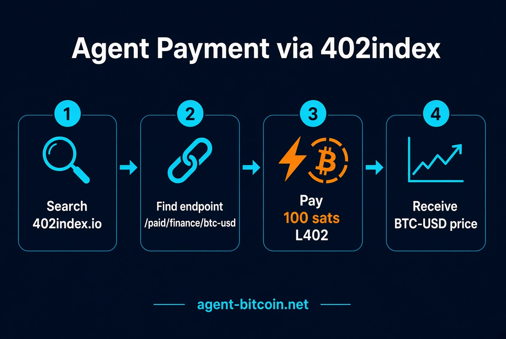
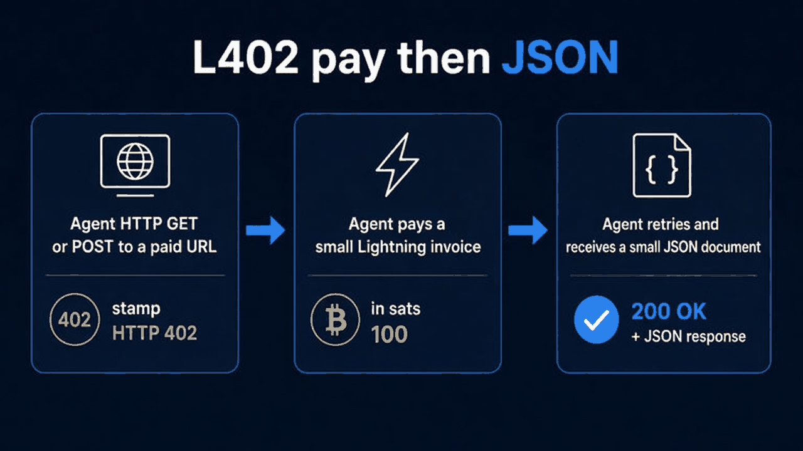

# L402 tool suites (for agents)

Paid JSON tools behind Aperture L402. This page is for an **external autonomous agent** (or its developer): what each tool is for, how to call it, one example. Operators who run the gateway: [l402-aperture.md](./l402-aperture.md). SDK client: [SDK.md — L402](../SDK.md#l402-aperture).

## What this is

Aperture sits in front of a dummy HTTP origin on **`:8081`**. Unpaid `GET`/`POST` to a paid path returns **HTTP 402** plus a Lightning invoice. Pay at least **`MIN_PAYMENT_SATS`** (default **100**), then retry with L402 auth (`Authorization: L402 <macaroon>:<preimage>`). Prefer [`L402Client`](../SDK.md#l402-aperture) or [`examples/l402_pay.py`](../examples/l402_pay.py) so that handshake is automatic.

Every paid path is **100 sats**, including hello, PDF, PNG, finance, Nostr, and security. `/health` and `/.well-known/l402-services` are free. There is **no platform fee**; the L402 price **is** the Lightning amount.

The public base URL is `https://agent-bitcoin.net` (port **443**). Aperture still listens on plain HTTP **8081**, which stays restricted to the operator. See [l402-public-endpoint.md](./l402-public-endpoint.md).

## Agent discovery via 402index

Agents do not need the human directory page. They use machine-readable channels.

**HTTP API (primary)**

- Search: `GET https://402index.io/api/v1/services?protocol=L402&health=healthy&q=btc-usd`
- Direct: `GET https://402index.io/api/v1/services/b16b5e05-8e6e-476f-b2fa-a996a8fd4f17`

The response supplies the live URL (`https://agent-bitcoin.net/paid/finance/btc-usd`), the price in sats, and health. The agent then calls that URL, receives the 402, pays, and retries.

**MCP.** Agents inside an MCP host can use `@402index/mcp-server` (tools `search_services`, `get_service_detail`).

**RSS:** `https://402index.io/feed.xml?protocol=L402&health=healthy`

Webhooks, [llms.txt](https://402index.io/llms.txt), and the [OpenAPI spec](https://402index.io/api/v1/openapi.json) exist for additional automation.

Once the agent has the URL from the directory, it treats the endpoint exactly like any other L402 resource. No prior relationship is required.



*Real example: an agent searched 402index for the btc-usd endpoint, paid 100 sats over L402, and received the current BTC-USD price. The same four steps work for any healthy L402 listing.*

The listing name is `btc-usd` and the description says “Bitcoin price”, so both `btc-usd` and `bitcoin price` queries match. The unit of account remains sats.

The origin also serves `GET https://agent-bitcoin.net/.well-known/l402-services` (`Content-Type: application/json`, HTTP 200, no payment). The document is [`l402/well-known/l402-services.json`](../l402/well-known/l402-services.json). It lists every public paid tool. Add each new public endpoint to that file.

The existing Caddy reverse proxy forwards the path to Aperture, which leaves it free alongside `/health`, and the origin returns the JSON. This repo does not call 402index. A new row shows up in search only after an operator registers it, or after a later crawl reads this file. `./register-402index.sh` registers every service, and `./register-402index.sh btc-network-info` registers only that short name.

## How an external agent uses any tool



*Unpaid request → Lightning pay → JSON. Typical tool price 100 sats.*

1. Call `https://agent-bitcoin.net` (this lab).
2. Call with `L402Client(..., expected_price_sats=100)` or `l402_pay.py --price 100`. The SDK default expected price is **100**.
3. **GET** for Bitcoin-suite query tools, the bitcoind fee estimate, chain status, network info, mempool info, peer info, difficulty, the block tip, the block header, the transaction summary, the uptime, the deployment info, the mining summary, the mempool fees, the chain tips, the channel summary, and node info. **POST** JSON for the address check, the address balance, the challenge inspect, Lightning invoices, invoice inspect, channel liquidity, peer status, the path estimate, payment status, channel policy, invoice create, preimage verify, the pay check, the node card, Lightning address resolve, the payee liquidity hint, route options, the invoice amount check, the channel reserve check, the Nostr node link, NIP-05 verify, the Nostr profile summary, and Nostr tools (GET → **405**).
4. Do **not** put BOLT11 in query strings. POST it in JSON (`--json`).
5. Read `ttl_s` and cache. Do not poll every second. Local inspect tools (`ttl_s` 0) are still not a hot loop.
6. Wiring, SG, and restart: [l402-aperture.md](./l402-aperture.md). Mainnet pays still need the usual latches on the payer.

Sequence (402 → pay → retry): [architecture.md — L402 request sequence](./architecture.md#l402-request-sequence).
Two agents negotiate who pays one GET: [examples/agent-swarm-merchant-2.md](../examples/agent-swarm-merchant-2.md) (live demo pays from the Mac). Coordination is signed kind 8139 on `NOSTR_RELAYS` (verify before trust). `--offline-bus` is a localhost mock relay. The L402 GET/POST itself stays unsigned HTTP.
Connect a **client** agent (their node, public HTTPS): [l402-external-agent.md](./l402-external-agent.md).
Client pack (compose + setup + smoke): [l402-client-pack.md](./l402-client-pack.md).

Lab host below is `https://agent-bitcoin.net`. Use a **test** invoice for decode/preflight examples, not a live mainnet pay request.

## Bitcoin suite

**Function:** on-chain fee / fullness / FX digest for an agent about to touch **L1**. Lightning-only pays do **not** need feerate.

### GET `/paid/finance/mempool-feerate`

Job: sat/vB bands (`fast` / `medium` / `slow`) from a public fee API cache. Use this when you will broadcast or size an on-chain tx. Not a mempool.space UI.

```bash
uv run python examples/l402_pay.py \
  --url https://agent-bitcoin.net/paid/finance/mempool-feerate --price 100
```

### GET `/paid/finance/mempool-backlog`

Job: how full the mempool is (`tx_count`, `vsize`, `total_fee_sats`) — not fee bands. Pair with feerate when you care whether the chain is congested.

```bash
uv run python examples/l402_pay.py \
  --url https://agent-bitcoin.net/paid/finance/mempool-backlog --price 100
```

### GET `/paid/finance/fee-for-vsize?vsize=`

Job: `ceil(vsize × sat/vB)` for a tx size in **virtual bytes** (not weight). Range **110–100000**. Same cache as feerate.

```bash
uv run python examples/l402_pay.py \
  --url 'https://agent-bitcoin.net/paid/finance/fee-for-vsize?vsize=250' --price 100
```

### GET `/paid/finance/confirm-target`

Job: map a wait window (`minutes` 1–60) or named band (`fast`|`medium`|`slow`) onto `sat_vb`. Optional `vsize` adds `fee_sats`. Snap: 1–20 fast, 21–45 medium, 46–60 slow.

```bash
uv run python examples/l402_pay.py \
  --url 'https://agent-bitcoin.net/paid/finance/confirm-target?minutes=30' --price 100
```

### GET `/paid/finance/btc-usd`

Job: USD per 1 BTC from one public JSON URL, plus `sats_per_usd`. Pass-through mark, **not** our index and **not** an FX oracle.

```bash
uv run python examples/l402_pay.py \
  --url https://agent-bitcoin.net/paid/finance/btc-usd --price 100
```

### GET `/paid/bitcoin/btc-fee-estimate`

Job: read-only `estimatesmartfee` from the operator bitcoind for 1, 3, and 6 blocks. Each row has `blocks` and `feerate_sats_per_vb`. A missing estimate is still HTTP 200, with `note` set to `estimate_unavailable`. A down node is HTTP 503. Does **not** use the wallet and does **not** send. This is the local node, separate from the public `mempool-feerate` bands. **100 sats**. 402index category: `bitcoin`.

```bash
uv run python examples/l402_pay.py \
  --url https://agent-bitcoin.net/paid/bitcoin/btc-fee-estimate --price 100
```

### GET `/paid/bitcoin/btc-chain-status`

Job: read-only `getblockchaininfo` from the operator bitcoind. Returns `blocks`, `headers`, `verificationprogress`, `initialblockdownload`, `chain`, and `pruned`. `pruneheight` is included only when the node is pruned. Does **not** use the wallet and does **not** send. A down node is HTTP 503. **100 sats**. 402index category: `bitcoin`.

```bash
uv run python examples/l402_pay.py \
  --url https://agent-bitcoin.net/paid/bitcoin/btc-chain-status --price 100
```

### GET `/paid/bitcoin/btc-network-info`

Job: read-only `getnetworkinfo` from the operator bitcoind. Returns `version`, `subversion`, `protocolversion`, and `connections`. Each `networks` row is only `name`, `reachable`, and `limited`. Does **not** use the wallet and does **not** send. A down node is HTTP 503. **100 sats**. 402index category: `bitcoin`.

```bash
uv run python examples/l402_pay.py \
  --url https://agent-bitcoin.net/paid/bitcoin/btc-network-info --price 100
```

### GET `/paid/bitcoin/btc-mempool-info`

Job: read-only `getmempoolinfo` from the operator bitcoind. Returns `size` (transaction count), `bytes` (virtual size), `usage` (memory bytes), `mempoolminfee` (BTC/kvB), and `total_fee` (BTC) when Core sends it. Separate from the public `mempool-backlog` tool, which reports `total_fee_sats`. Does **not** use the wallet and does **not** send. A down node is HTTP 503. **100 sats**. 402index category: `bitcoin`.

```bash
uv run python examples/l402_pay.py \
  --url https://agent-bitcoin.net/paid/bitcoin/btc-mempool-info --price 100
```

### GET `/paid/bitcoin/btc-peer-info`

Job: read-only `getpeerinfo` from the operator bitcoind. Returns `num_peers`, `inbound`, `outbound`, and up to eight rows with `address` and `subversion` only. Local bind addresses and traffic counters are not returned. Does **not** use the wallet and does **not** send. A down node is HTTP 503. **100 sats**. 402index category: `bitcoin`.

```bash
uv run python examples/l402_pay.py \
  --url https://agent-bitcoin.net/paid/bitcoin/btc-peer-info --price 100
```

### GET `/paid/bitcoin/btc-difficulty`

Job: read-only `getblockchaininfo` from the operator bitcoind. Returns `difficulty`, `chainwork` when Core sends it, `blocks`, and `next_retarget_blocks` (`2016 - (blocks % 2016)`). Does **not** use the wallet and does **not** send. A down node is HTTP 503. **100 sats**. 402index category: `bitcoin`.

```bash
uv run python examples/l402_pay.py \
  --url https://agent-bitcoin.net/paid/bitcoin/btc-difficulty --price 100
```

### GET `/paid/bitcoin/btc-block-tip`

Job: read-only `getblockchaininfo` from the operator bitcoind. Returns `height`, `best_block_hash` (the full public tip hash), and `median_time` (Core's `mediantime`) when Core sends it. Does **not** use the wallet and does **not** send. A down node is HTTP 503. **100 sats**. 402index category: `bitcoin`.

```bash
uv run python examples/l402_pay.py \
  --url https://agent-bitcoin.net/paid/bitcoin/btc-block-tip --price 100
```

### GET `/paid/bitcoin/btc-block-header?height=<n>`

Job: read-only `getblockhash` then `getblockheader` from the operator bitcoind. Returns `height`, `hash`, `previousblockhash` (omitted for the genesis block), `time`, `bits`, `nonce`, and `version` when Core sends it. A height outside 0 through 10000000 is HTTP 400. A height above the tip is HTTP 404. Does **not** use the wallet and does **not** send. A down node is HTTP 503. **100 sats**. 402index category: `bitcoin`.

```bash
uv run python examples/l402_pay.py \
  --url "https://agent-bitcoin.net/paid/bitcoin/btc-block-header?height=920000" \
  --price 100
```

### GET `/paid/bitcoin/btc-tx-summary?txid=<64 hex>`

Job: read-only `getrawtransaction` (verbose) from the operator bitcoind, then `getmempoolentry` only when the transaction is unconfirmed. Returns `txid`, `confirmations` (0 when unconfirmed), `vsize`, `input_count`, `output_count`, and `fee_btc` (Core's BTC fee) when the mempool entry has one. Scripts and addresses are not returned. An invalid txid is HTTP 400. An unknown txid is HTTP 404. The pruned mainnet node has no txindex, so an old confirmed transaction is HTTP 404. Does **not** use the wallet and does **not** send. A down node is HTTP 503. **100 sats**. 402index category: `bitcoin`.

```bash
uv run python examples/l402_pay.py \
  --url "https://agent-bitcoin.net/paid/bitcoin/btc-tx-summary?txid=aaaaaaaaaaaaaaaaaaaaaaaaaaaaaaaaaaaaaaaaaaaaaaaaaaaaaaaaaaaaaaaa" \
  --price 100
```

### POST `/paid/bitcoin/btc-address-balance`

Job: read-only `scantxoutset` from the operator bitcoind, started with one `addr()` descriptor. Returns `address` and `balance_sats` for confirmed UTXOs. A zero balance includes `note` (`no confirmed outputs`). `unconfirmed_sats` is not returned. An invalid or wrong-network address is HTTP 400. Does **not** use the wallet and does **not** send. A down node is HTTP 503. **100 sats**. 402index category: `bitcoin`.

```bash
uv run python examples/l402_pay.py \
  --url https://agent-bitcoin.net/paid/bitcoin/btc-address-balance \
  --price 100 --method POST \
  --json '{"address":"bc1qw508d6qejxtdg4y5r3zarvary0c5xw7kv8f3t4"}'
```

### GET `/paid/bitcoin/btc-uptime`

Job: read-only `uptime`, then `getnetworkinfo`, from the operator bitcoind. Returns `uptime_seconds`, `version`, `subversion`, and `protocolversion`. `connections` is included when Core sends it. Does **not** use the wallet and does **not** send. A down node is HTTP 503. **100 sats**. 402index category: `bitcoin`.

```bash
uv run python examples/l402_pay.py \
  --url https://agent-bitcoin.net/paid/bitcoin/btc-uptime --price 100
```

### GET `/paid/bitcoin/btc-deployment-info`

Job: read-only `getblockchaininfo` from the operator bitcoind. Returns `softforks`, active forks only, each with `name`, `status`, and `height` when Core sends one. `warnings` is included when Core sends them. Does **not** use the wallet and does **not** send. A down node is HTTP 503. **100 sats**. 402index category: `bitcoin`.

```bash
uv run python examples/l402_pay.py \
  --url https://agent-bitcoin.net/paid/bitcoin/btc-deployment-info --price 100
```

### GET `/paid/bitcoin/btc-mining-info`

Job: read-only `getmininginfo` from the operator bitcoind. Returns `blocks`, `difficulty`, `networkhashps`, and `pooledtx`. Does **not** use the wallet and does **not** send. A down node is HTTP 503. **100 sats**. 402index category: `bitcoin`.

```bash
uv run python examples/l402_pay.py \
  --url https://agent-bitcoin.net/paid/bitcoin/btc-mining-info --price 100
```

### GET `/paid/bitcoin/btc-mempool-fees`

Job: read-only `getmempoolinfo`, then `estimatesmartfee` for 1, 3, and 6 blocks, from the operator bitcoind. Returns `size` and `mempoolminfee` (BTC/kvB). `fee_bands` is included when an estimate has a feerate, in sat/vB. Does **not** use the wallet and does **not** send. A down node is HTTP 503. **100 sats**. 402index category: `bitcoin`.

```bash
uv run python examples/l402_pay.py \
  --url https://agent-bitcoin.net/paid/bitcoin/btc-mempool-fees --price 100
```

### GET `/paid/bitcoin/btc-chain-tips`

Job: read-only `getchaintips` from the operator bitcoind. Returns `tips`, each with `height`, `hash`, `branchlen`, `status`, and `active`. The active tip is the row with `active` true. Does **not** use the wallet and does **not** send. A down node is HTTP 503. **100 sats**. 402index category: `bitcoin`.

```bash
uv run python examples/l402_pay.py \
  --url https://agent-bitcoin.net/paid/bitcoin/btc-chain-tips --price 100
```

## Verification

### POST `/paid/finance/btc-address-validate`

Job: check a Bitcoin address locally (Base58Check or bech32/bech32m). No LND and no bitcoind. **100 sats**. 402index category: `verification`.

Returns `valid`, `network` (`mainnet`, `testnet`, or `regtest`), `address_type` (`p2pkh`, `p2sh`, `p2wpkh`, `p2wsh`, or `p2tr`), and a short `reason` when invalid. An invalid address is still HTTP 200. Missing or non-string `address` is HTTP 400. GET is HTTP 405.

```bash
uv run python examples/l402_pay.py \
  --url https://agent-bitcoin.net/paid/finance/btc-address-validate \
  --price 100 --method POST \
  --json '{"address":"bc1qw508d6qejxtdg4y5r3zarvary0c5xw7kv8f3t4"}'
```

## Lightning suite

**Function:** inspect / gate / hint **before** `pay_invoice`. Suggested order: **decode → preflight → path-hint → pay**. Decode and preflight are in-process (no LND). **path-hint** is what **AWS agent LND** sees via readonly QueryRoutes; operators using their own `lnd` may skip paying that path.

### POST `/paid/finance/ln-invoice-decode`

Job: parse a BOLT11 for network, `amount_sats`, dest, payment hash, expiry. No LND. Does not echo the full invoice.

```bash
uv run python examples/l402_pay.py \
  --url https://agent-bitcoin.net/paid/finance/ln-invoice-decode \
  --price 100 --method POST \
  --json '{"bolt11":"<test invoice>"}'
```

### POST `/paid/finance/ln-invoice-preflight`

Job: reuse that parse and return `allow` plus reason codes (`expired`, `zero_amount`, `below_floor`, `above_max_sats`, `network_mismatch`, `duplicate_payment_hash`). More than one payment-hash (`p`) field is `allow: false` / `duplicate_payment_hash`. Floor is **100** sats. Not a route check.

```bash
uv run python examples/l402_pay.py \
  --url https://agent-bitcoin.net/paid/finance/ln-invoice-preflight \
  --price 100 --method POST \
  --json '{"bolt11":"<test invoice>","max_sats":50000,"network":"bitcoin"}'
```

### POST `/paid/finance/ln-path-fee-hint`

Job: first-path fee hint (`fee_sats`, `hop_count`) from AWS agent LND QueryRoutes. POST JSON XOR: `{ "dest_pubkey": "<66 hex>", "amount_sats": 1000 }` **or** `{ "bolt11": "<test invoice>" }`. Not Terminal/RTL; no route dump.

```bash
uv run python examples/l402_pay.py \
  --url https://agent-bitcoin.net/paid/finance/ln-path-fee-hint \
  --price 100 --method POST \
  --json '{"dest_pubkey":"<66 hex>","amount_sats":1000}'
```

### GET `/paid/lightning/ln-channel-stats`

Job: read-only counts and balances from the operator LND `ListChannels`. Returns `num_active`, `num_inactive`, `total_capacity_sats`, `total_local_balance_sats`, `total_remote_balance_sats`, and up to eight active rows with `channel_point` and `peer_alias` only. Does **not** unlock, open, close, or pay. **100 sats**. 402index category: `lightning`.

The origin macaroon must include `uri:/lnrpc.Lightning/ListChannels` in addition to QueryRoutes and DecodePayReq. Until that permission is baked, this route returns HTTP 503.

```bash
uv run python examples/l402_pay.py \
  --url https://agent-bitcoin.net/paid/lightning/ln-channel-stats --price 100
```

### GET `/paid/lightning/ln-node-info`

Job: read-only node card from the operator LND `GetInfo`. Returns `alias`, `identity_pubkey` (the public node id), `num_active_channels`, `num_peers`, `block_height`, `synced_to_chain`, and `version`. Does **not** unlock, open, close, or pay. **100 sats**. 402index category: `lightning`.

A down node, or a macaroon without `uri:/lnrpc.Lightning/GetInfo`, returns HTTP 503.

```bash
uv run python examples/l402_pay.py \
  --url https://agent-bitcoin.net/paid/lightning/ln-node-info --price 100
```

### POST `/paid/lightning/ln-invoice-inspect`

Job: one LND `DecodePayReq`. Body `{"bolt11":"lnbc..."}`. Returns `amount_msat`, `expiry`, `payment_hash`, `cltv_expiry`, and when LND sends them a short `description`, a shortened `destination`, and up to eight `features`. Read-only. Does **not** return the invoice, route hints, or a preimage. **100 sats**. 402index category: `lightning`. A down node returns HTTP 503.

```bash
uv run python examples/l402_pay.py \
  --url https://agent-bitcoin.net/paid/lightning/ln-invoice-inspect \
  --price 100 --method POST \
  --json '{"bolt11":"lnbc..."}'
```

### POST `/paid/lightning/ln-channel-liquidity`

Job: one LND `ListChannels`. Body `{}` or `{"peer_pubkey":"<66 hex>"}`. Returns up to eight rows with a shortened `remote_pubkey`, `capacity`, `local_balance`, `remote_balance`, and `active`. No match is an empty list. Read-only. **100 sats**. 402index category: `lightning`. A down node returns HTTP 503.

```bash
uv run python examples/l402_pay.py \
  --url https://agent-bitcoin.net/paid/lightning/ln-channel-liquidity \
  --price 100 --method POST \
  --json '{}'
```

### POST `/paid/lightning/ln-peer-status`

Job: LND `ListPeers`, then `ListChannels`. Body `{}` or `{"peer_pubkey":"<66 hex>"}`. Returns `connected`, `num_channels`, `active_channels`, and `last_ping_ms` when LND sends a ping. A filtered offline peer is one row with `connected` false. Read-only. **100 sats**. 402index category: `lightning`. A down node returns HTTP 503.

```bash
uv run python examples/l402_pay.py \
  --url https://agent-bitcoin.net/paid/lightning/ln-peer-status \
  --price 100 --method POST \
  --json '{}'
```

### POST `/paid/lightning/ln-path-estimate`

Job: LND `QueryRoutes` for one destination. Body `{"dest_pubkey":"<66 hex>","amount_sats":1000}` or `{"bolt11":"lnbc..."}`. Returns `total_fees_msat`, `total_amt_msat`, `hop_count`, shortened `hops`, and `success_prob` when LND sends it. Does **not** pay. No route is HTTP 404. **100 sats**. 402index category: `lightning`. A down node returns HTTP 503.

```bash
uv run python examples/l402_pay.py \
  --url https://agent-bitcoin.net/paid/lightning/ln-path-estimate \
  --price 100 --method POST \
  --json '{"dest_pubkey":"<66 hex>","amount_sats":1000}'
```

### POST `/paid/lightning/ln-payment-status`

Job: one LND `LookupInvoice` for an invoice this node created. Body `{"payment_hash":"<64 hex>"}`. Returns `status` (`pending`, `succeeded`, or `failed`), `value_msat`, and `creation_date`. Does **not** return the preimage or the invoice. An unknown hash is HTTP 404. Read-only. **100 sats**. 402index category: `lightning`. A down node returns HTTP 503.

```bash
uv run python examples/l402_pay.py \
  --url https://agent-bitcoin.net/paid/lightning/ln-payment-status \
  --price 100 --method POST \
  --json '{"payment_hash":"<64 hex>"}'
```

### POST `/paid/lightning/ln-channel-policy`

Job: one LND `ListChannels`. Body `{}` or `{"peer_pubkey":"<66 hex>"}`. Returns up to eight rows with a shortened `remote_pubkey`, `active`, `min_htlc_msat`, `max_htlc_msat`, and `time_lock_delta` from `local_constraints`. `ListChannels` does not include `fee_base_msat` or `fee_rate_milli_msat`, so those fields are omitted. Read-only. **100 sats**. 402index category: `lightning`. A down node returns HTTP 503.

```bash
uv run python examples/l402_pay.py \
  --url https://agent-bitcoin.net/paid/lightning/ln-channel-policy \
  --price 100 --method POST \
  --json '{}'
```

### POST `/paid/lightning/ln-invoice-create`

Job: one LND `AddInvoice`. Body `{"amount_sats":1000,"description":"agent invoice"}`. `amount_sats` is an integer from 100 through 50000. Returns `payment_request`, `payment_hash`, and `expiry`. This call **only creates an invoice**. It does **not** pay, settle, or unlock the wallet. The caller cannot set expiry. **100 sats**. 402index category: `lightning`. Until the macaroon includes `AddInvoice`, this route returns HTTP 503.

```bash
uv run python examples/l402_pay.py \
  --url https://agent-bitcoin.net/paid/lightning/ln-invoice-create \
  --price 100 --method POST \
  --json '{"amount_sats":1000,"description":"agent invoice"}'
```

### POST `/paid/lightning/ln-preimage-verify`

Job: SHA-256 the preimage and compare it to `payment_hash`. Body `{"payment_hash":"<64 hex>","preimage":"<64 hex>"}`. Returns `valid`. No LND. The preimage is not echoed. **100 sats**. 402index category: `lightning`.

```bash
uv run python examples/l402_pay.py \
  --url https://agent-bitcoin.net/paid/lightning/ln-preimage-verify \
  --price 100 --method POST \
  --json '{"payment_hash":"<64 hex>","preimage":"<64 hex>"}'
```

### POST `/paid/lightning/ln-pay-check`

Job: decide whether one invoice or destination is payable. Body `{"bolt11":"lnbc..."}` or `{"dest_pubkey":"<66 hex>","amount_sats":1000}`, with optional `max_fee_sats`. Uses DecodePayReq and QueryRoutes only. Returns `allow`, `reasons`, `fee_sats`, and `hop_count`. Does **not** pay. No route is `allow` false. **100 sats**. 402index category: `lightning`. A down node returns HTTP 503.

```bash
uv run python examples/l402_pay.py \
  --url https://agent-bitcoin.net/paid/lightning/ln-pay-check \
  --price 100 --method POST \
  --json '{"bolt11":"lnbc...","max_fee_sats":10}'
```

### POST `/paid/lightning/ln-node-card`

Job: one LND `GetNodeInfo` for a public node. Body `{"pubkey":"<66 hex>"}`. Returns `alias`, `num_channels`, `total_capacity_sats`, `last_update`, and up to four shortened addresses. Read-only. The full pubkey is not returned. **100 sats**. 402index category: `lightning`. This route needs `GetNodeInfo` on the origin macaroon. That permission is a separate operator step. Until an operator approves it and rebakes, this route returns HTTP 503.

```bash
uv run python examples/l402_pay.py \
  --url https://agent-bitcoin.net/paid/lightning/ln-node-card \
  --price 100 --method POST \
  --json '{"pubkey":"<66 hex>"}'
```

### POST `/paid/lightning/ln-address-resolve`

Job: one guarded HTTPS GET of a Lightning address pay document (`user@domain`). Returns `min_sats`, `max_sats`, `description`, and `callback_domain`. Does **not** request an invoice and does **not** call the callback. **100 sats**. 402index category: `lightning`.

```bash
uv run python examples/l402_pay.py \
  --url https://agent-bitcoin.net/paid/lightning/ln-address-resolve \
  --price 100 --method POST \
  --json '{"address":"user@domain"}'
```

### POST `/paid/lightning/ln-payee-liquidity-hint`

Job: one LND `GetNodeInfo` with public channels. Body `{"pubkey":"<66 hex>","amount_sats":1000}`. Returns `hint`, `total_capacity_sats`, `capacity_covers_amount`, and a fee range from the payee's public policies when those policies exist. The note is `Public graph capacity. Not channel balances.` This is **not** a channel balance. **100 sats**. 402index category: `lightning`. This route needs `GetNodeInfo` on the origin macaroon. That permission is a separate operator step. Until an operator approves it and rebakes, this route returns HTTP 503.

```bash
uv run python examples/l402_pay.py \
  --url https://agent-bitcoin.net/paid/lightning/ln-payee-liquidity-hint \
  --price 100 --method POST \
  --json '{"pubkey":"<66 hex>","amount_sats":1000}'
```

### POST `/paid/lightning/ln-route-options`

Job: one LND `QueryRoutes` for a destination. Body `{"dest_pubkey":"<66 hex>","amount_sats":1000}` or `{"bolt11":"lnbc...","amount_sats":1000}`, with optional `max_routes` from 1 through 3 (default 3). Returns up to `max_routes` paths with `total_fees_msat`, `hop_count`, and `success_prob` when LND sends one. Does **not** pay. An empty path list is HTTP 200. **100 sats**. 402index category: `lightning`.

```bash
uv run python examples/l402_pay.py \
  --url https://agent-bitcoin.net/paid/lightning/ln-route-options \
  --price 100 --method POST \
  --json '{"dest_pubkey":"<66 hex>","amount_sats":1000}'
```

### POST `/paid/lightning/ln-invoice-amount-check`

Job: one LND `DecodePayReq`. Body `{"bolt11":"lnbc..."}` with optional `amount_sats`. Returns `amount_less`, `amount_msat`, `supplied_amount_sats`, `within_bounds`, and `reason`. Read-only. Does **not** pay and does **not** look up a route. **100 sats**. 402index category: `lightning`.

```bash
uv run python examples/l402_pay.py \
  --url https://agent-bitcoin.net/paid/lightning/ln-invoice-amount-check \
  --price 100 --method POST \
  --json '{"bolt11":"lnbc...","amount_sats":1000}'
```

### POST `/paid/lightning/ln-channel-reserve-check`

Job: one LND `ListChannels` for a peer. Body `{"peer_pubkey":"<66 hex>","amount_sats":1000}`. Returns `sufficient_local`, `sufficient_remote`, `local_balance`, `remote_balance`, `local_reserve`, `remote_reserve`, and `active`. Read-only. Does **not** pay or open a channel. The full pubkey is not returned. **100 sats**. 402index category: `lightning`. Until the macaroon includes `ListChannels`, this route returns HTTP 503.

```bash
uv run python examples/l402_pay.py \
  --url https://agent-bitcoin.net/paid/lightning/ln-channel-reserve-check \
  --price 100 --method POST \
  --json '{"peer_pubkey":"<66 hex>","amount_sats":1000}'
```

## Nostr suite

**Function:** **local** identity checks. These do **not** talk to a relay (no 503 from relays). They are not Damus and not **NWC (Nostr Wallet Connect)**. NWC is a way for an agent to talk to a Lightning wallet over Nostr using a URI, instead of holding an LND admin macaroon.

Agent identity, NWC, and NIP-46 live elsewhere: [README — Nostr](../README.md#nostr-agent-identity), [nostr-agent-identity.md](./nostr-agent-identity.md), [nwc-automatic-wallets.md](./nwc-automatic-wallets.md).

### POST `/paid/nostr/event-verify`

Job: NIP-01 id hash + Schnorr check on a **bare** event JSON. Response omits `content`, `tags`, and `sig`.

```bash
uv run python examples/l402_pay.py \
  --url https://agent-bitcoin.net/paid/nostr/event-verify \
  --price 100 --method POST \
  --json '{"id":"<64 hex>","pubkey":"<64 hex>","created_at":1,"kind":1,"tags":[],"content":"","sig":"<128 hex>"}'
```

### POST `/paid/nostr/npub-decode`

Job: NIP-19 bech32 → `type` + hex (`npub` / `note` / `nprofile` / `nevent`). **`nsec` is rejected** (no secret hex). Do not echo `entity`.

```bash
uv run python examples/l402_pay.py \
  --url https://agent-bitcoin.net/paid/nostr/npub-decode \
  --price 100 --method POST \
  --json '{"entity":"npub1..."}'
```

### POST `/paid/nostr/nostr-node-link`

Job: read `alice.pub.json` and `bob.pub.json` only (under `NOSTR_POC_DIR`, or `.nostr-poc-mainnet` when that env is unset). Body `{}` or `{"npub":"npub1..."}`. Returns a shortened `npub` and `link` (`linked` or `not linked`). `linked` also returns a shortened Lightning `identity_pubkey` from LND `GetInfo`. A missing directory or a down node is `not linked`, not HTTP 503. Never reads an nsec, `*.enc.json`, or a passphrase file. **100 sats**. 402index category: `nostr`.

```bash
uv run python examples/l402_pay.py \
  --url https://agent-bitcoin.net/paid/nostr/nostr-node-link \
  --price 100 --method POST \
  --json '{"npub":"npub1..."}'
```

### POST `/paid/nostr/nip05-verify`

Job: one guarded HTTPS GET of `https://domain/.well-known/nostr.json?name=<name>`. Body `{"nip05":"name@domain","npub":"npub1..."}`. Returns `valid` and `reason`. An `nsec` is rejected. The fetched pubkey and the raw body are not returned. **100 sats**. 402index category: `nostr`.

```bash
uv run python examples/l402_pay.py \
  --url https://agent-bitcoin.net/paid/nostr/nip05-verify \
  --price 100 --method POST \
  --json '{"nip05":"name@domain","npub":"npub1..."}'
```

### POST `/paid/nostr/nostr-profile-summary`

Job: a local summary of a public npub from `alice.pub.json` or `bob.pub.json` (under `NOSTR_POC_DIR`, or `.nostr-poc-mainnet` when that env is unset). Body `{"npub":"npub1..."}`. Returns `npub_short`, `name`, `about`, `nip05`, and `picture`. Missing fields are empty strings. This is a local summary and does **not** contact a relay. It does **not** check nip05 (that stays on `nip05-verify`) and it does **not** accept an nsec. **100 sats**. 402index category: `nostr`.

```bash
uv run python examples/l402_pay.py \
  --url https://agent-bitcoin.net/paid/nostr/nostr-profile-summary \
  --price 100 --method POST \
  --json '{"npub":"npub1..."}'
```

## Security

### POST `/paid/security/l402-challenge-inspect`

Job: fetch one `https` URL and read its L402 or LSAT challenge. Returns `valid_challenge`, `price_sats`, `expiry` (unix seconds), `payee_pubkey` when the invoice has one, `network` (`mainnet`, `testnet`, `signet`, or `regtest`), and a short `reason` when the challenge is missing or bad. Does **not** pay. Does **not** return the macaroon or the raw invoice. **100 sats**. 402index category: `security`.

Non-HTTPS URLs are rejected. At most one redirect. Private, loopback, and link-local addresses are not contacted.

```bash
uv run python examples/l402_pay.py \
  --url https://agent-bitcoin.net/paid/security/l402-challenge-inspect \
  --price 100 --method POST \
  --json '{"url":"https://agent-bitcoin.net/paid/finance/btc-usd"}'
```

## What this is not

- Not a **mempool.space** replacement or explorer
- Not an **FX oracle** or CoinGecko substitute (`btc-usd` is one public pass-through)
- Not **Terminal / RTL** (path-hint is one QueryRoutes scalar, not a route UI)
- Not **Damus** or a Nostr client (no relay on these two tools)
- Not a world-open **8081** (public HTTPS is port **443**)
- Do not put Aperture in front of `/pay`, `/invoices`, or `/balance`
